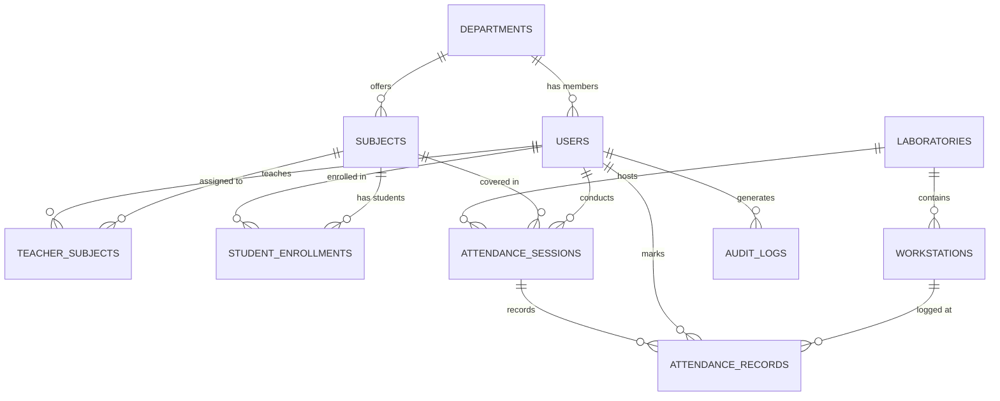

# 🎓 Labora – Smart Digital Attendance & Laboratory Control System
*(Technical Project Name: Lab-Secure)*


-green)


**Labora** is a modern, full-stack laboratory attendance verification and live monitoring platform developed specifically for academic computer laboratories and universities. It replaces slow, error-prone, paper-based sheets and easily spoofed proxy methods with high-security physical workstation locking, real-time WebSocket seat telemetry, automated attendance analytics, and a modern React + Tailwind CSS single-page interface with full dark/light theme support.

---

## 🚀 Quick Start Guide

### 1. Prerequisites
- **Python 3.10+** (with virtual environment `venv`)
- **Node.js 18+** & **npm**

### 2. Backend Setup
```bash
# Activate virtual environment (Windows PowerShell)
.\venv\Scripts\Activate.ps1

# Install Python requirements
pip install -r requirements.txt

# Seed development demo data (Admin, Faculty, Subjects, Labs, Students)
python -m flask seed-demo
```

### 3. Frontend Setup & Build
```bash
# Build React frontend for production (hosted directly by Flask)
npm run build

# OR run Vite frontend in live hot-reload development mode (on port 5173)
npm run dev
```

### 4. Run Application
```bash
# Start Flask Backend (on http://127.0.0.1:5000)
.\venv\Scripts\python.exe run.py
```
> When running Flask directly, it automatically serves the compiled Labora React application on `http://127.0.0.1:5000/`. When running `npm run dev`, Vite runs on `http://localhost:5173` with instant hot-reloading and proxies all API and WebSocket requests to Flask.

---

## 🔑 Demo Login Credentials

| Role | Username | Password | Access / Portal |
|---|---|---|---|
| **Administrator** | `admin` | `AdminSecurePassword!123` | `/admin` (4 items: Overview, User Accounts, Academics, Laboratories) |
| **Faculty / Teacher** | `prof.sharma` | `TeacherPassword123` | `/teacher` (3 items: Overview, Add Subject, Launch Attendance Portal) |
| **Student** | `21CS001` | `StudentPassword123` | `/student` (Single-Click Check-in, Defaulter Alerts, Excel Export) |

---

## 🎨 Labora Design System & UI Architecture

Labora features a SaaS interface built on the purple gradient brand palette:
- **Primary Purple:** `#7515A8`
- **Bright Violet:** `#722BE3`
- **Deep Purple:** `#3D116B`
- **Dark Background:** `#09090B` | **Dark Surface:** `#15121B`
- **Light Background:** `#FFFFFF` | **Light Secondary:** `#F6F5F9`

### Key UI Features:
1. **Full Light & Dark Theme Support:** Persistent toggle saved in `localStorage`.
2. **Landing Page:** Interactive typewriter hero cycling 5 phrases, alternating feature highlights, 3-step timeline, working `/api/contact` inquiry form, and responsive footer.
3. **Admin Dashboard:**
   - Sidebar strictly contains 4 items: *Overview, User Accounts, Academics, Laboratories*.
   - Overview strictly features 3 primary stat cards: *Total Students, Total Faculty, Total Computer Laboratories*.
   - User Accounts: Filter tabs, search, Add User modal (dynamic faculty/student fields), and CSV Bulk Import with preview and error checking.
   - Academics: Department and Subject management with teacher assignments.
   - Laboratories: 30/60/90 workstation capacity and subnet range configuration.
4. **Teacher Portal:**
   - Sidebar strictly contains 3 items: *Overview, Add Subject, Launch Attendance Portal*.
   - Attendance Portal features 2 dedicated tabs:
     - **Live Monitoring:** Dynamic 30/60/90 workstation grid with real-time Socket.IO check-ins, countdown timer, pause/resume, extend (+10m), and session termination.
     - **Student Analysis:** Real-time roster, at-risk defaulter highlight (<75%), and Recharts visual analytics.
5. **Student Portal:**
   - Active session card with live workstation detection and single-click check-in.
   - Overall attendance progress ring with red warning banner for defaulters (<75%).
   - Subject-wise attendance progress bars.
   - Personal attendance history table and direct `.xlsx` export download.

---

## 1. Project Overview

Academic computer laboratories face unique attendance challenges:
- **Proxy attendance:** Students share links, QR codes, or passwords with absent peers.
- **Unreliable networks:** College Wi-Fi or DHCP setups fluctuate and cause false IP claims.
- **Slow manual roster tracking:** Teachers waste 15–20 minutes circulating paper sheets while supervising experiments.
- **Lack of immediate feedback:** Faculty cannot see who is seated where in real-time.

**Lab-Secure** solves this by tying student attendance directly to verified physical workstations in the laboratory. Attendance is only permitted during an active session conducted by an authorized teacher, from a verified workstation within the laboratory's authorized network subnet. Faculty observe an interactive 30/60/90-PC workstation grid that updates instantaneously via WebSockets as students check in.

---

## 2. Key Features

### 🏢 Workstation-Based Physical Security
- **Hardware & Network Validation:** Verifies that student requests originate from authorized workstation IPs or cryptographically provisioned workstation registration tokens.
- **Seat Collision Protection:** Strictly blocks two students from claiming the same computer in a session.
- **Duplicate Attendance Prevention:** Enforces atomic database constraints preventing students from checking in more than once per session.
- **Subject Enrollment Verification:** Verifies server-side that the student is registered for the course.

### 🔴 Real-Time Interactive Monitoring Dashboard
- **Dynamic Workstation Grid:** Visualizes 30, 60, or 90 PCs matching actual laboratory layouts.
- **Color-Coded Status Nodes:** 
  - ⚪ **Available:** Unoccupied seat ready for check-in.
  - 🟢 **Attended:** Checked-in student with live pulse animation, name, enrollment ID, and exact timestamp.
  - ⚪ **Maintenance / Inactive:** Disabled workstation.
- **Isolated Socket.IO Rooms:** Faculty only receive live notifications for their specific active laboratory session (`session_{session_id}`).
- **Real-Time Counters:** Instant calculations of Present Count, Pending Count, and Completion Rate.

### ⏱️ Session Lifecycle Management
- **One-Click Launch:** Teachers configure subject, laboratory room, workstation capacity (30, 60, or 90), and duration (default 10 mins).
- **Session Controls:** Pause/Resume attendance, extend session duration (+10 minutes), or manually stop the session.
- **Live Countdown Timer:** Visual countdown badge (Green &rarr; Warning Yellow &rarr; Urgent Red) for both faculty and students.

### 📊 Attendance Analytics & Automated Reporting
- **At-Risk Tracking:** Automatically flags students below the mandatory **75% attendance threshold** with visual alerts.
- **Styled Excel Reports (.xlsx):** Generates styled multi-column attendance reports using **OpenPyXL** and **Pandas** with auto-adjusted column widths, session metadata headers, and summary rows.
- **Printable Reports:** Printable HTML reports with browser-native PDF export (`@media print`).
- **Cumulative Multi-Date Reports:** Date range filtering across faculty subjects.

### 🛡️ Enterprise Security & Administration
- **Password Security:** Hashes all credentials using **Argon2id** (memory: 64MB, 3 iterations, 4 parallelism threads). Zero plaintext password storage.
- **Role-Based Access Control (RBAC):** Strict server-side route decorators (`@admin_required`, `@teacher_required`, `@student_required`).
- **CSRF & Rate Limiting:** Global CSRF tokens on all POST endpoints via `Flask-WTF` and brute-force mitigation on authentication and attendance routes via `Flask-Limiter`.
- **Audit Logging:** System-wide audit trail recording user logins, session activations, attendance submissions, and administrative events.
- **Bulk CSV / Excel Student Import:** Administrative tool to ingest hundreds of student accounts at once.

---

## 3. Technology Stack

| Layer | Technologies |
|---|---|
| **Backend Framework** | Python 3.10+, Flask 3.1.2, Flask Blueprints, Application Factory Pattern |
| **Authentication & Security** | Argon2id (`argon2-cffi`), Flask-Login, Flask-WTF (CSRF), Flask-Limiter |
| **Database & ORM** | SQLite 3 with WAL Mode, SQLAlchemy 2.0 ORM, Flask-Migrate (Alembic) |
| **Real-Time Communications**| Flask-SocketIO 5.5, Python-EngineIO, WebSockets with HTTP polling fallback |
| **Data Processing & Export** | Pandas 2.2, OpenPyXL 3.1, XlsxWriter |
| **Frontend UI/UX** | HTML5, CSS3 Custom Properties, Bootstrap 5.3, Bootstrap Icons, Vanilla ES6+ JavaScript |
| **Production WSGI & Proxy** | Gunicorn (Eventlet Worker), Nginx Reverse Proxy, Systemd |
| **Testing Suite** | Pytest 8.x |

---

## 4. Application Architecture

```
                                      [ Physical Lab Workstations ]
                                                   │
                                      [ College LAN / Subnet ]
                                                   │
                                            HTTPS / WSS
                                                   │
                                      ┌────────────────────────┐
                                      │   Nginx Reverse Proxy  │ (SSL, Rate Limits, Static Assets)
                                      └───────────┬────────────┘
                                                  │
                                      ┌───────────┴────────────┐
                                      │  Gunicorn / Eventlet   │ (WSGI Server, Port 5000)
                                      └───────────┬────────────┘
                                                  │
                       ┌──────────────────────────┴──────────────────────────┐
                       │               Flask Application Factory             │
                       │   (CSRF, Limiter, ProxyFix, Security Headers)       │
                       └──────────────────────────┬──────────────────────────┘
                                                  │
                 ┌────────────────────────────────┼────────────────────────────────┐
                 │                                │                                │
           [Blueprints]                    [Service Layer]                  [Socket.IO Rooms]
          ├── auth                        ├── AuthService                  ├── session_{id}
          ├── admin                       ├── AttendanceService            └── Global updates
          ├── teacher                     ├── SessionService
          ├── student                     ├── WorkstationService
          ├── attendance                  ├── ReportService
          ├── reports                     └── AuditService
          └── api
                 │                                │
                 └────────────────────────────────┼────────────────────────────────┘
                                                  │
                                       [ SQLAlchemy 2.0 ORM ]
                                                  │
                                  ┌───────────────┴───────────────┐
                                  │   SQLite Database Engine      │
                                  │   - Journal Mode: WAL         │
                                  │   - Foreign Keys: ON          │
                                  │   - Busy Timeout: 15,000 ms   │
                                  │   - Synchronous: NORMAL       │
                                  └───────────────────────────────┘
```

---

## 5. Project Directory Structure

```
Digital-Student-Attendance-System/
├── .env                              # Active environment configuration
├── .env.example                      # Production environment template
├── .gitignore                        # Git exclusion rules
├── requirements.txt                  # Locked Python dependencies
├── run.py                            # Application entry point
├── create_data.py                    # Interactive admin initialization utility
│
├── app/                              # Core Flask Application Package
│   ├── __init__.py                   # Application Factory (create_app) & CLI commands
│   ├── config.py                     # Environment configurations (Dev, Test, Prod)
│   ├── extensions.py                 # Extensions & SQLite PRAGMA event listener
│   ├── models.py                     # SQLAlchemy Database models
│   ├── routes.py                     # Legacy routes deprecation shim
│   │
│   ├── blueprints/                   # Modular Blueprints
│   │   ├── auth/                     # Authentication & password management
│   │   ├── admin/                    # Admin portal, user CRUD, lab CRUD, CSV import
│   │   ├── teacher/                  # Faculty portal, session controls, history
│   │   ├── student/                  # Student portal, live detector, personal export
│   │   ├── attendance/               # Attendance submission & Socket.IO room events
│   │   ├── reports/                  # Styled Excel generation & printable reports
│   │   └── api/                      # Health-check endpoint & JSON stats
│   │
│   ├── services/                     # Business Logic & Service Layer
│   │   ├── auth_service.py           # Login check, Argon2 verification, audit logging
│   │   ├── attendance_service.py     # 9-point server validation & atomic write
│   │   ├── session_service.py        # Lab session lifecycle (start, pause, stop, extend)
│   │   ├── workstation_service.py    # IP subnet mapping & workstation provisioning
│   │   ├── report_service.py         # OpenPyXL Excel generator & at-risk engine
│   │   └── audit_service.py          # Centralized audit logging
│   │
│   ├── utils/                        # Reusable Utility Modules
│   │   ├── decorators.py             # Role-based access decorators (@admin_required, etc.)
│   │   ├── security.py               # Argon2id password hasher & token utilities
│   │   └── network.py                # Client IP extraction & subnet verification
│   │
│   ├── static/                       # Static Assets
│   │   ├── css/
│   │   │   ├── main.css              # Deep navy/indigo SaaS design system
│   │   │   └── workstation_grid.css  # 30/60/90 responsive workstation grid styles
│   │   └── js/
│   │       ├── main.js               # Theme toggle, toast helper, sidebar behavior
│   │       ├── live_monitor.js       # Socket.IO room listener & live grid animations
│   │       └── student_attendance.js # Asynchronous AJAX attendance submitter
│   │
│   └── templates/                    # Jinja2 Templates
│       ├── base/base.html            # Master SaaS layout with responsive sidebar
│       ├── auth/login.html           # Institutional split-screen sign-in
│       ├── student/dashboard.html    # Student dashboard & live session detector
│       ├── teacher/dashboard.html    # Teacher panel, live grid, roster, & session actions
│       ├── admin/                    # Admin dashboard, users, labs, workstations, academics
│       ├── reports/print_single.html # Printable attendance layout
│       └── errors/                   # Custom 403, 404, 500 error pages
│
├── deploy/                           # Production Deployment Configurations
│   ├── gunicorn.conf.py              # Eventlet WSGI configuration
│   ├── nginx.conf                    # Nginx reverse proxy with WebSocket support
│   ├── labsecure.service             # Systemd service unit file
│   └── backup_sqlite.sh              # SQLite WAL online backup script
│
├── instance/                         # SQLite Data Directory
│   └── attendance.db                 # Primary SQLite database
│
└── tests/                            # Automated Pytest Suite
    ├── conftest.py                   # Pytest fixtures and test database setup
    ├── test_auth.py                  # Argon2id and authentication tests
    ├── test_security_rbac.py         # Role permissions & access restriction tests
    ├── test_workstation.py           # Workstation provisioning and IP tests
    ├── test_attendance.py            # Comprehensive attendance & collision tests
    └── test_reports.py               # At-risk calculation and OpenPyXL export tests
```

---

## 6. Database Design (SQLite Only)

The application uses **SQLite** as its primary database. SQLite was selected for simplicity, zero maintenance overhead, and reliability in physical institutional server setups.

### Concurrency & High Performance Tuning
To ensure SQLite handles concurrent attendance requests without write conflicts or database lockups:
1. **Write-Ahead Logging (WAL Mode):** Enabled via `PRAGMA journal_mode=WAL;`. Readers never block writers, and writers never block readers.
2. **Foreign Key Enforcement:** Strict relational integrity via `PRAGMA foreign_keys=ON;`.
3. **Synchronous Optimization:** Tuned with `PRAGMA synchronous=NORMAL;` for optimal disk write throughput while guaranteeing ACID reliability.
4. **Busy Timeout Handling:** Configured with `PRAGMA busy_timeout=15000;` (15 seconds) plus an application-level exponential backoff retry in `AttendanceService` to handle peak check-in bursts.
5. **Database Location:** Protected in the `instance/` folder with strict filesystem permissions (not exposed over HTTP).

### Entity-Relationship Diagram



### Table Definitions & Constraints
- `users`: Primary accounts (`admin`, `teacher`, `student`). Password hashes stored as Argon2id.
- `departments`: Academic branches (`CSE`, `IT`, `ECE`, etc.).
- `subjects`: Courses with department and semester links.
- `teacher_subjects`: Unique constraint `(teacher_id, subject_id)`.
- `student_enrollments`: Unique constraint `(student_id, subject_id)`.
- `laboratories`: Lab rooms, IP boundaries (`ip_start`, `ip_end`, `subnet_cidr`), default capacity.
- `workstations`: Unique constraint `(lab_id, seat_number)`. Index on `(lab_id, ip_address)`.
- `attendance_sessions`: Live session state (`is_active`, `is_paused`, `start_time`, `end_time`, `session_code`).
- `attendance_records`:
  - **Unique Constraint:** `(session_id, student_id)` &rarr; Student cannot mark twice.
  - **Unique Constraint:** `(session_id, workstation_id)` &rarr; Seat cannot be shared.
- `audit_logs`: Timestamped event history with user ID, action, target, IP address, and details.

---

## 7. Installation & Setup Instructions

### Prerequisites
- Python 3.10, 3.11, or 3.12
- Git
- SQLite 3

### Step 1: Clone the Repository
```bash
git clone https://github.com/vedantjadhav07/Digital-Student-Attendece-System.git
cd Digital-Student-Attendece-System
```

### Step 2: Create and Activate Virtual Environment
**On Windows (PowerShell):**
```powershell
python -m venv venv
.\venv\Scripts\activate
```

**On Linux / macOS:**
```bash
python3 -m venv venv
source venv/bin/activate
```

### Step 3: Install Required Dependencies
```bash
pip install -r requirements.txt
```

---

## 8. Environment Configuration

Copy `.env.example` to `.env`:
```bash
cp .env.example .env
```

Ensure the `.env` file contains your local parameters:
```ini
FLASK_APP=run.py
FLASK_ENV=development
DEBUG=True

# In production, generate a secure 64-char key using:
# python -c "import secrets; print(secrets.token_hex(32))"
SECRET_KEY=lab_secure_dev_secret_key_8e94a8f93e2b47d10e5f96c3a1b8d24f

# Database Path
DATABASE_URL=sqlite:///attendance.db

# Concurrency & Performance
SQLITE_TIMEOUT=15
SQLITE_WAL_MODE=True

# Network & Proxy
BEHIND_PROXY=False
TRUSTED_PROXIES=127.0.0.1

# Session Security
SESSION_COOKIE_HTTPONLY=True
SESSION_COOKIE_SAMESITE=Lax
SESSION_COOKIE_SECURE=False
```

---

## 9. Database Initialization

### Option A: Clean Database (Production Setup)
To start with a clean database containing empty tables:
```bash
flask db-init
```

### Option B: Optional Development Seed Dataset
To populate the database with sample departments, laboratories (Lab 1 with 30 PCs, Lab 2 with 60 PCs), subjects, faculty, and test students:
```bash
flask seed-demo
```
*Demo Credentials:*
- **Admin:** `admin` / `AdminSecurePassword!123`
- **Teacher:** `prof.sharma` / `TeacherPassword123`
- **Student:** `21CS001` / `StudentPassword123`

---

## 10. Administrator Account Provisioning

Administrator credentials are **never hardcoded**. Create your primary root administrator securely via CLI:

### Interactive Secure Provisioning
```bash
python create_data.py
```
*Prompts for Administrator Username, Full Name, Email, and hidden Password (verified twice).*

### CLI Alternative
```bash
flask create-admin --username admin --name "Head Administrator"
```

---

## 11. Running the Application

### Development Server
```bash
python run.py
```
The server will start on `http://0.0.0.0:5000` (accessible from any PC on the lab network).

Open your browser and navigate to:
```
http://127.0.0.1:5000
```

---

## 12. Automated Testing

The project includes an automated test suite verifying password security, role permissions, workstation binding, duplicate rejection, and report generation.

Run the test suite with **pytest**:
```bash
pytest tests/ -v
```

Expected result:
```
====================== 20 passed in 9.29s =======================
```

---

## 13. Workstation Registration & Lab Network Configuration

1. Log in to the **Admin Portal** (`/admin/dashboard`).
2. Navigate to **Laboratories** &rarr; click **Add Laboratory**.
3. Specify:
   - **Laboratory Name:** e.g., `Lab 3 - Microprocessors`
   - **Lab Code:** `LAB3`
   - **Default Capacity:** Choose `30`, `60`, or `90` workstations.
   - **IP Range Start:** e.g., `192.168.3.1`
   - **IP Range End:** e.g., `192.168.3.60`
4. When saved, the system auto-provisions workstations (`LAB3-WS01` through `LAB3-WS60`) with matching IP bindings and secret tokens.
5. In **Workstations** (`/admin/workstations`), administrators can toggle status between `Active`, `Maintenance`, and `Inactive`.

---

## 14. Security Implementation Details

1. **Argon2id Cryptographic Hashes:** All user passwords are encrypted using `argon2-cffi`. Hashes cannot be reversed even in the event of an offline database exposure.
2. **Server-Side Validation Only:** Neither client-side IP claims nor workstation seat numbers from the frontend are trusted. All network matches are performed using `request.remote_addr` and the server's database.
3. **Seat Collision Checks:** Database uniqueness prevents two students from marking at the same workstation.
4. **CSRF Protection:** All forms include cryptographic CSRF tokens checked on every non-GET request.
5. **Rate Limiting:** Protects `/login` (15/min) and `/attendance/submit` (10/min) from brute-force scripts.
6. **Security Headers:** Enforces `X-Frame-Options: SAMEORIGIN`, `X-Content-Type-Options: nosniff`, `X-XSS-Protection: 1; mode=block`, and `Referrer-Policy: strict-origin-when-cross-origin`.
7. **Audit Logging:** Every login attempt, failed verification, session state change, and database modification is recorded with timestamp and client IP.

---

## 15. Production Deployment (Linux / Ubuntu Server)

### Step 1: Install System Packages
```bash
sudo apt update
sudo apt install -y python3-venv python3-pip nginx sqlite3 libevent-dev
```

### Step 2: Deploy Application
```bash
sudo mkdir -p /var/www/labsecure
sudo cp -r . /var/www/labsecure
cd /var/www/labsecure

python3 -m venv venv
source venv/bin/activate
pip install -r requirements.txt
pip install eventlet gunicorn
```

### Step 3: Initialize Database & Admin
```bash
flask db-init
python create_data.py
```

### Step 4: Configure Permissions
```bash
sudo chown -R www-data:www-data /var/www/labsecure
sudo chmod -R 770 /var/www/labsecure/instance
```

### Step 5: Setup Systemd Service
```bash
sudo cp deploy/labsecure.service /etc/systemd/system/
sudo systemctl daemon-reload
sudo systemctl enable labsecure
sudo systemctl start labsecure
```

Check status:
```bash
sudo systemctl status labsecure
```

### Step 6: Setup Nginx Reverse Proxy
```bash
sudo cp deploy/nginx.conf /etc/nginx/sites-available/labsecure
sudo ln -s /etc/nginx/sites-available/labsecure /etc/nginx/sites-enabled/
sudo nginx -t
sudo systemctl restart nginx
```

### Step 7: Verify Health Check
```bash
curl http://localhost/health
```
Output:
```json
{"database":"connected","status":"healthy","timestamp":"2026-11-04T15:39:44","version":"2.0.0-production"}
```

---

## 16. Database Backup and Restoration

### Automated Snapshot Backup
Run the backup script manually or configure a daily cron job:
```bash
bash deploy/backup_sqlite.sh
```
*Creates an atomic, WAL-consistent backup file in `instance/backups/attendance_backup_YYYYMMDD_HHMMSS.db` using SQLite's online backup API.*

### Backup via Web Interface
Administrators can create an instant snapshot backup directly from **Admin Dashboard** &rarr; **Backup Database Snapshot**.

### Database Restoration
To restore a snapshot:
```bash
# 1. Stop service
sudo systemctl stop labsecure

# 2. Restore file
cp instance/backups/attendance_backup_YYYYMMDD_HHMMSS.db instance/attendance.db

# 3. Fix permissions
chown www-data:www-data instance/attendance.db

# 4. Restart service
sudo systemctl start labsecure
```

---

## 👨‍💻 Maintainer & Author

- **Vedant Jadhav**  
  Department of Computer Science & Engineering  
  Walchand College of Engineering

---

## 📄 License
This project is licensed under the MIT License.
